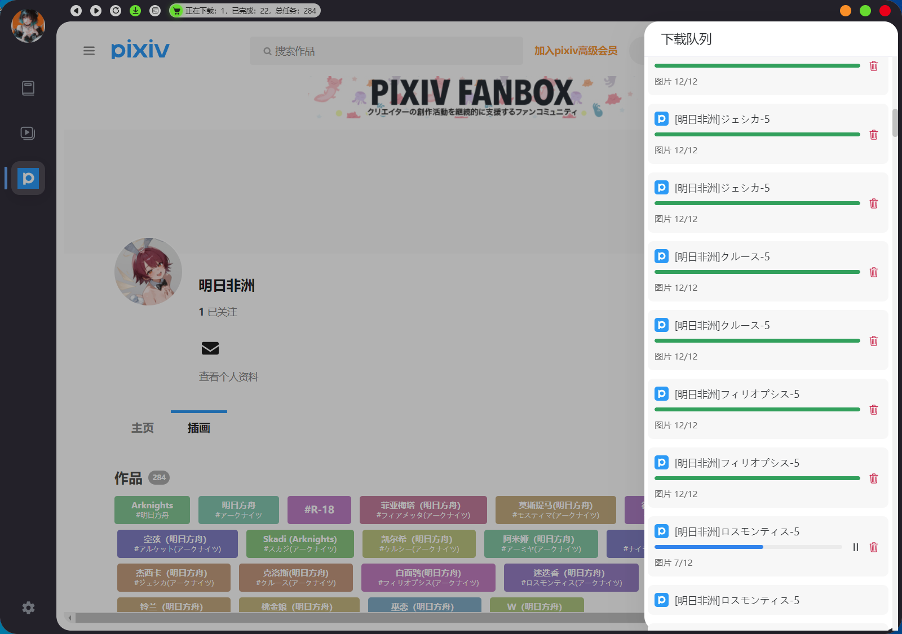
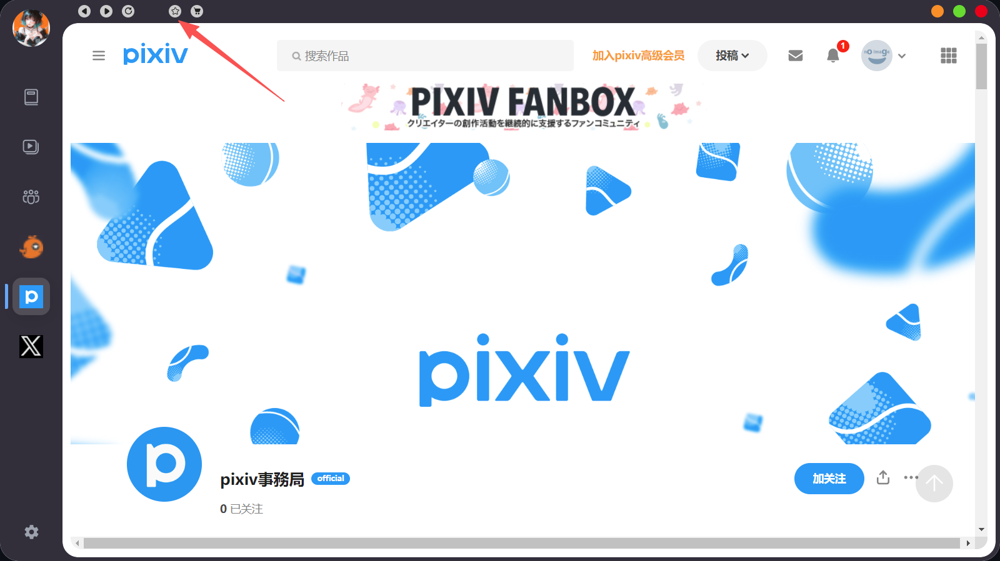
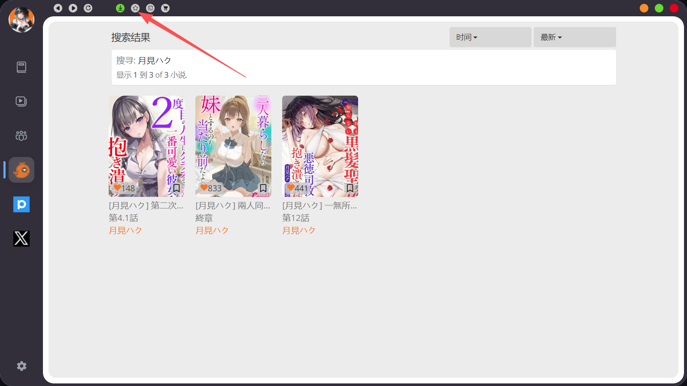
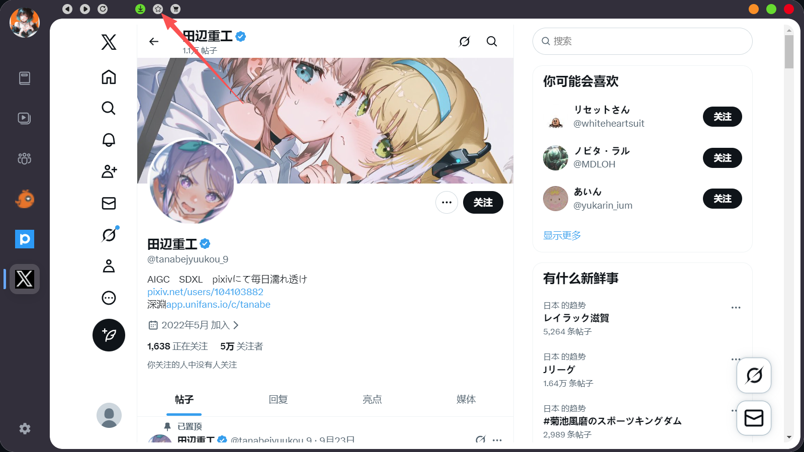
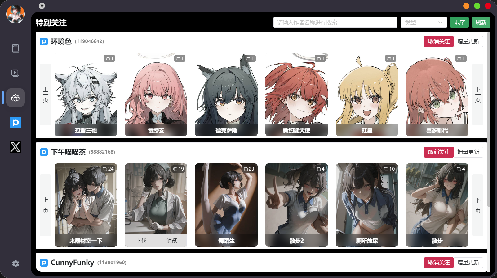
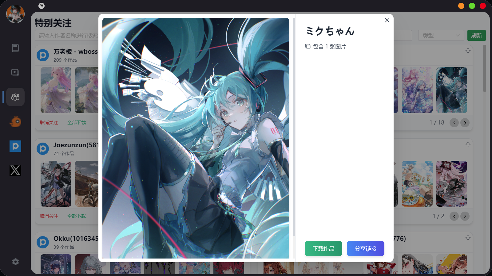
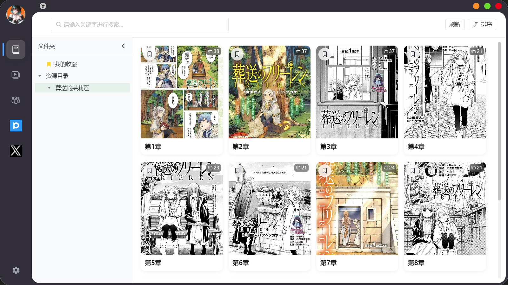
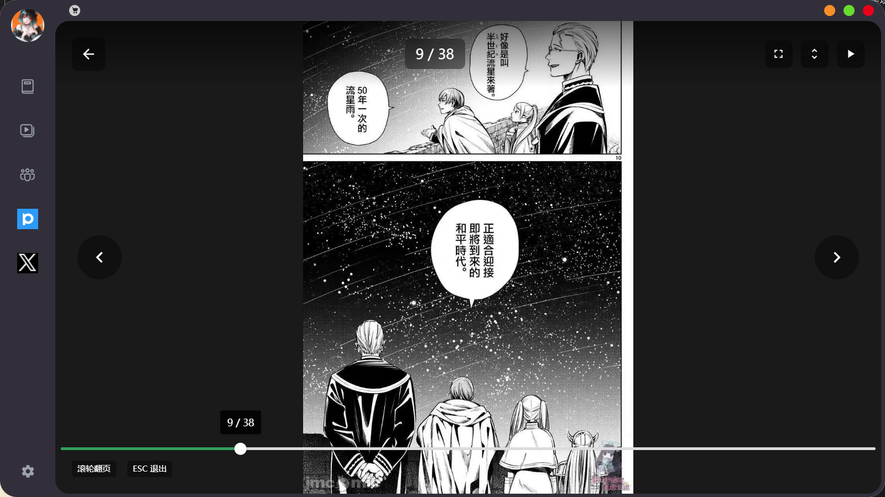
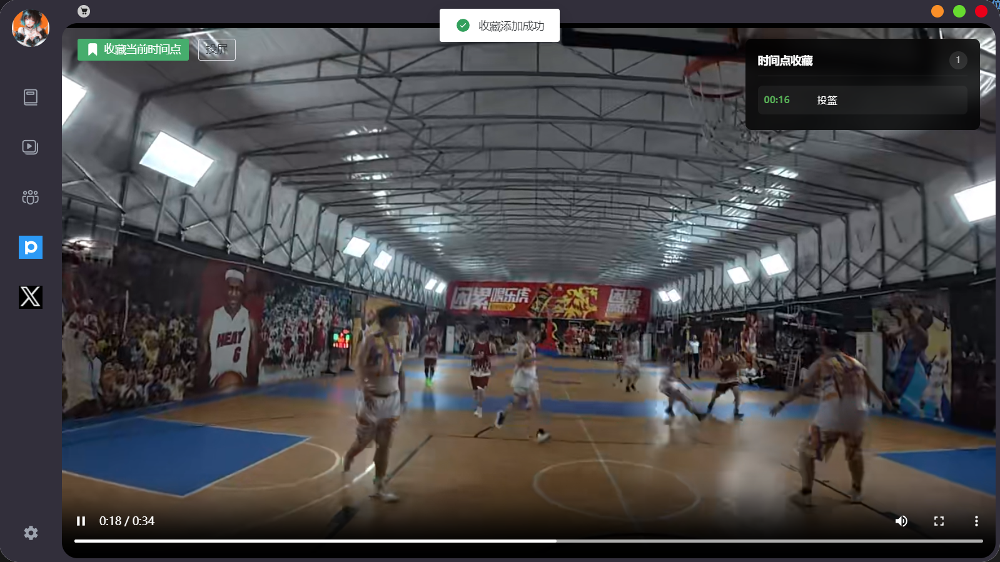
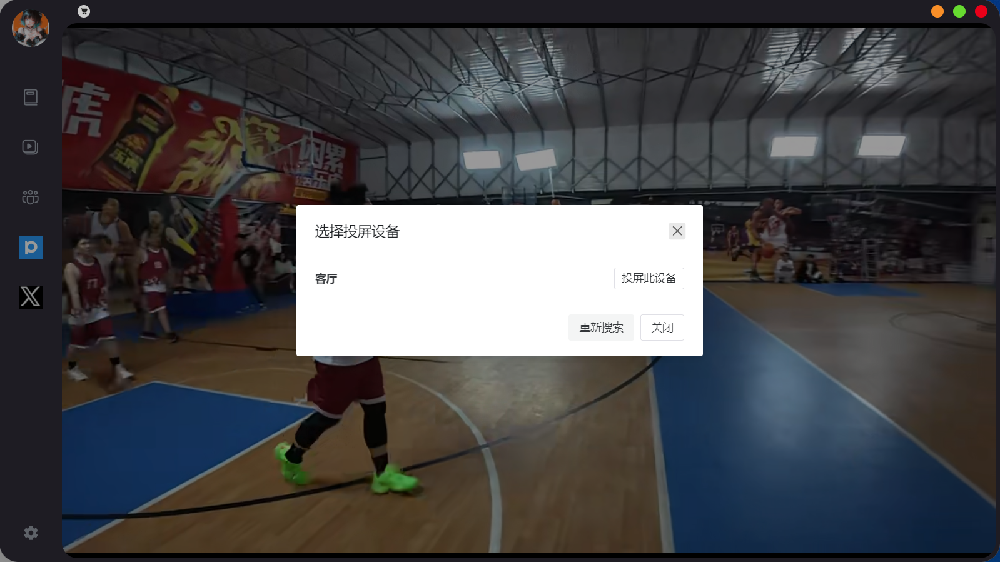

# Comic Reader

本地漫画/视频阅读与多站点聚合浏览下载工具。基于 Electron + Vue3 + Vite，支持图片/PDF/EPUB 漫画阅读、视频播放（书签、DLNA 投屏、AI 字幕生成与翻译），内置 10+ 第三方站点的浏览与下载抓取。

- 丰富功能：标签收藏、浏览历史、投屏、特别关注、随机阅读、多站搜索
- 一体化体验：本地媒体库（书架）+ 在线站点预览与下载 + 统一任务中心
- 性能优化：虚拟列表、Keep-Alive 缓存，流畅浏览大量资源

## 功能特性

### 站点浏览与下载

- WebView 站点：Pixiv、Twitter、微博、绅士漫画、 禁漫
- 进入作品或作者页面，下载图标显示时点击即可下载，任务统一在任务中心管理
- 各站点支持独立下载路径；站点入口可在设置页显示/隐藏

  **注意：内置代理地址固定为 127.0.0.1:7890**

### 特别关注

- 支持站点：Pixiv、禁漫、Twitter、微博、，在对应页面点击收藏按钮即可关注
- 列表展示：新作品提醒、本地下载情况、按名称/关注时间/作品数排序
- 预览：查看作品详情，支持 Pixiv 动图（Ugoira）播放

### 书架（媒体库）

- 漫画与视频统一管理：3D 书籍/光盘盒卡片、打开飞入动画、书架缩放
- 文件管理：右键菜单支持重命名、移动（目录树选择）、删除（含空文件夹清理）、分享、复制标题
- 收藏夹、浏览历史、最近下载
- 随机阅读：随机漫游书架（可选媒体类型），快速翻到一部作品
- 视频卡片展示分辨率与时长

### 阅读器

- 图片阅读器：翻页、缩放、键鼠操作、自动播放、翻页动画、侧键回退
- 缩略图导航面板（抽屉式）
- 阅读设置：阅读模式 / 页面模式 / 翻页方向、控制栏显示模式、进度条开关
- 支持格式：jpg / jpeg / png / webp、PDF、EPUB

### 视频模块

- 播放器：本地文件 / HLS 流播放，进度管理
- 书签功能：时间点收藏、增删改查
- DLNA 投屏：局域网设备发现与投屏
- AI 字幕：whisper.cpp 语音识别生成字幕，@electron/llm 本地模型或 Google 翻译（依赖在设置页一键下载）
- 视频修复：损坏视频一键转码修复
- 番茄短剧站内播放与历史观看

### 搜索与下载辅助

- 多站点批量搜索：选择站点、每行一个关键字批量检索
- 剪贴板弹窗：监听剪贴板内容快捷搜索（弹窗位置可配置）
- 局域网中转服务：可开关的局域网代理中转（端口可配置）

## 功能截图

|                                             |                                         |                                         |
| ------------------------------------------- | --------------------------------------- | --------------------------------------- |
| **下载任务中心**                            | **特别关注 · Pixiv**                    | **特别关注 · JM**                       |
|     |  |        |
| **特别关注 · Twitter**                      | **特别关注 · 列表**                     | **特别关注 · 预览**                     |
|  |  |            |
| **资源浏览器**                              | **阅读器**                              | **视频 · 时间点书签**                   |
|                |               |  |
| **视频 · DLNA 投屏**                        |                                         |                                         |
|                  |                                         |                                         |

## 快速开始

前置条件

- Node.js 18+
- npm 或 yarn

安装与启动

- 安装依赖
  - `npm install`
- 开发调试
  - `npm run dev`
- 预览（打包后预览）
  - `npm run start`
- 类型检查
  - `npm run typecheck`
- 代码格式化
  - `npm run format`

打包构建

- 通用构建
  - `npm run build`
- 针对平台的构建产物
  - Windows: `npm run build:win`
  - macOS: `npm run build:mac`
  - Linux: `npm run build:linux`

提示

- 开发模式打开 DevTools：`Ctrl/Cmd + Alt + Shift + L`
- 渲染进程 URL 由 `electron-vite` 管理，开发环境自动加载
- 字幕功能依赖（whisper.cpp / ffmpeg）无需手动安装，在设置页一键下载

## 技术栈

- 主进程：Electron、electron-updater、electron-log
- 预加载：@electron-toolkit/preload（contextBridge 安全暴露 API）
- 渲染层：Vue 3、Vite、Pinia、Vue Router、Naive UI、Tailwind CSS
- 阅读器：epubjs、vue-pdf-embed
- 视频/媒体：hls.js、mediabunny、sharp、whisper.cpp + ffmpeg（字幕，按需下载）
- AI：@electron/llm（本地字幕翻译）、@vitalets/google-translate-api
- 数据与存储：sqlite/sqlite3
- 其他：fast-glob、zip-lib、dlnacasts、bonjour-service、lodash、mime-types

## 许可证

本项目基于 MIT License 开源（见 `LICENSE`）。
